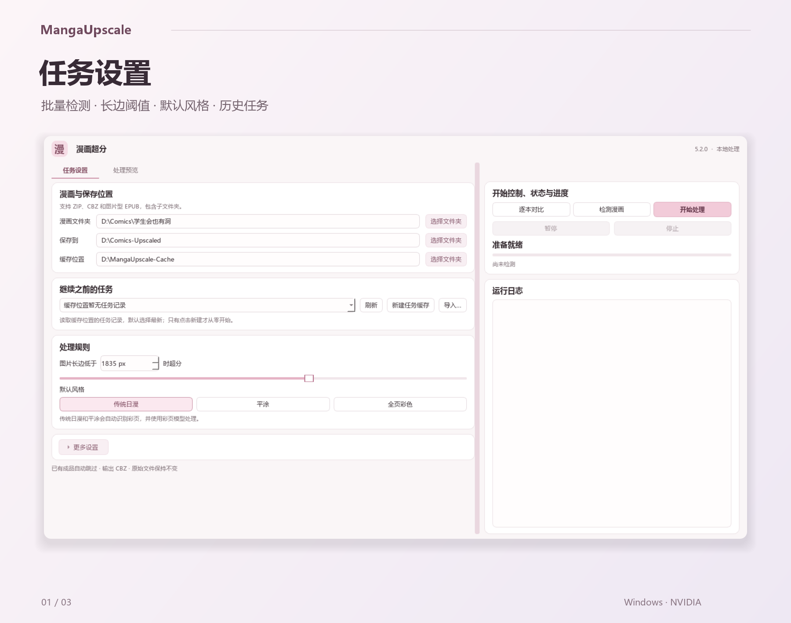
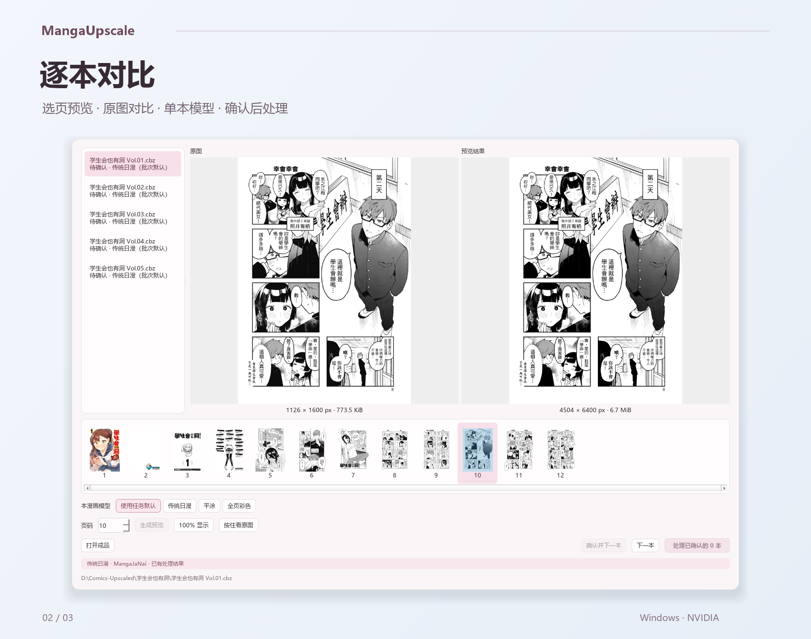
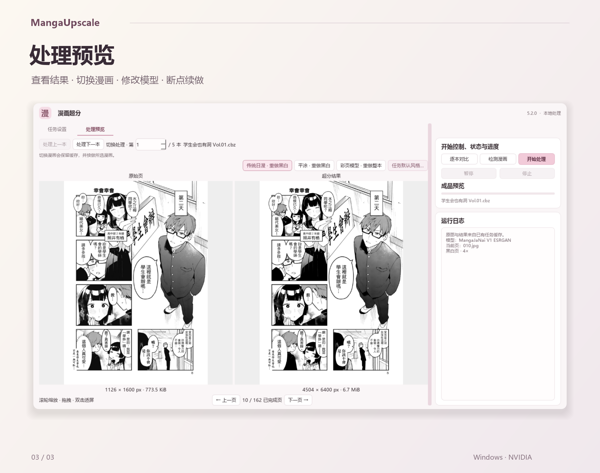

<div align="center">

# 漫画超分 · MangaUpscale

Windows 漫画批量超分工具，支持 ZIP、CBZ、图片型 EPUB，输出 CBZ。

[下载客户端](https://github.com/Duke486/MangaUpscale/releases/latest) · [使用说明](#开始使用) · [问题反馈](https://github.com/Duke486/MangaUpscale/issues)

</div>

## 任务设置

选择漫画、输出与缓存目录，设置超分尺寸和默认模型。支持子文件夹扫描、历史任务恢复、暂停和断点续做。源文件保持不变，成品校验通过后保存。



## 逐本对比

选择页面生成预览，左右对比原图与结果，支持缩放、拖动和按住看原图。每本可单独指定模型，确认后批量处理。



## 处理预览

查看已完成页面，切换处理的漫画，修改单本模型或任务默认风格。可重做黑白页并保留彩页缓存，也可用彩页模型重做整本。



## 开始使用

**运行环境：Windows 10 / 11 x64、NVIDIA 显卡、兼容 CUDA 12.8 的驱动，约 11 GB 可用空间，另需预留漫画缓存与成品空间。**

从 [Releases](https://github.com/Duke486/MangaUpscale/releases/latest) 下载 Windows x64 客户端并双击运行。当前版本为 **5.2.0**，文件名为 `MangaUpscale-5.2.0-Windows-x64.exe`。

客户端携带应用代码、基础 Python、nunif 源码与 7-Zip。首次启动会从 PyTorch、PyPI、MangaJaNai 与 nunif 上游安装依赖、下载模型，进度在安装窗口中显示；需下载数 GB 文件，失败后重新打开可重试。安装完成后可离线处理，彩页模型在首次使用时编译加速引擎。

1. 在「任务设置」选择漫画文件夹、保存位置与缓存位置，路径会自动保存。
2. 开始一批新漫画时，点击「新建任务缓存」；继续处理时，从「继续之前的任务」选择记录。
3. 设置「图片长边低于」的阈值和默认风格：传统日漫、平涂或全页彩色。达到阈值的页面保留原尺寸。
4. 点击「检测漫画」查看待处理数量，或进入「逐本对比」，选页生成预览并确认各本风格。
5. 点击「开始处理」或「继续处理」；在对比窗口中，也可点击「处理已确认的 N 本」。右侧可随时暂停、继续或停止。

<details>
<summary><strong>任务缓存与历史恢复</strong></summary>

「继续之前的任务」按漫画文件夹名与时间列出缓存记录，默认选择最新任务。需要从零开始时，点击「新建任务缓存」创建独立记录；已有断点也可通过「导入…」选择包含 `state/demand.json` 的任务目录。

任务默认风格保存在各自缓存中，恢复任务时沿用；新任务使用主界面当前所选风格。此版本使用独立任务格式，从旧版迁移时请新建缓存任务。

</details>

<details>
<summary><strong>逐本对比与处理预览</strong></summary>

逐本对比的缩略图可横向滚动，也支持滚轮横移；仅加载可见区域附近的原图缩略图。选择风格后点击「生成预览」，只处理当前页，确认则为整本保存实际风格。黑白页、彩页与保留原尺寸的页面均可确认。

两侧底部分别显示分辨率与图片大小。对比结果的大小是 PNG 预览文件大小，正式成品使用 JPG 95 编码。

处理预览中的「处理上一本 / 处理下一本」会切换实际处理目标，保留缓存并续做所选漫画。单本模型与重做操作直接显示为按钮。

</details>

<details>
<summary><strong>修改任务默认风格与重做</strong></summary>

在「处理预览」点击「任务默认风格…」，修改本任务当前列表内漫画包的默认风格。已手动选择风格、逐本确认或手动跳过的漫画默认保留；其余已完成漫画也会按新风格重做。

勾选「同时覆盖手动设置与跳过项」，会清除这些单包设置并统一重做。运行中提交的修改在当前漫画结束后应用；若先停止，尚未应用的修改保留到下次开始。旧成品在新成品校验通过后替换。

</details>

## 模型

| 风格 | 黑白页 | 彩页 |
| --- | --- | --- |
| 传统日漫 | MangaJaNai V1 ESRGAN，按长边匹配 1200–2048p 模型，4× | IllustrationJaNai V3detail FDAT M，原生 2× |
| 平涂 | waifu2x art，降噪 2，4× | IllustrationJaNai V3detail FDAT M，原生 2× |
| 全页彩色（强制全局彩页） | IllustrationJaNai V3detail FDAT M，原生 2× | IllustrationJaNai V3detail FDAT M，原生 2× |

传统日漫与平涂会自动识别彩页；全页彩色让所有页统一使用彩页模型，黑白页仍保留黑白内容。长边阈值与「跳过超出模型建议尺寸的页面」设置在三种风格下均生效。彩页使用上游 BF16 ONNX 模型，通过 TensorRT 加速。

继续旧任务时，会从本地快照更新旧版颜色检测结果。分类变化的漫画包会重新打包，未变化的页面复用缓存，新成品校验通过后替换旧成品。

## 输出格式

ZIP / CBZ 保留包内阅读顺序与原始页名；图片型 EPUB 按 spine 页序读取，输出使用连续页码。新任务保留原始包名，需要转为 JPEG 的页面使用 `.jpg` 扩展名。

处理只对低于所设长边阈值、且符合尺寸规则的页面进行超分，其余页面保留原尺寸。输出统一打包为 CBZ，可交给支持该格式的阅读器继续阅读。

## 开发与构建

Python 3.11+ 与 PySide6 桌面界面，PyTorch / nunif 处理黑白页，TensorRT 处理彩页。本地任务缓存保存进度与风格，运行环境通过 `runtime.json` 的相对路径配置，可随安装目录移动。

<details>
<summary><strong>开发环境与检查命令</strong></summary>

在 Windows x64、Python 3.11 或更新版本下安装开发依赖，再运行以下检查：

```powershell
python -m pip install -r requirements-dev.txt
python -m ruff check .
python -m ruff format --check .
python -B -m unittest discover -s tests -v
python -B backend/selftest.py
python -B packaging/selftest.py
```

检查覆盖 Ruff、合成图片回归、真实 Qt 事件循环、CPU 替身推理的打包与恢复流程，以及合成载荷的 Windows 启动器解包。测试使用合成数据，不调用 GPU、不读取真实漫画。也可将上述命令中的 `python` 替换为已安装开发依赖的 `./runtime/python/python.exe`。

相关代码入口：[桌面界面](gui.py) · [任务控制](controller.py) · [逐本对比](trial_dialog.py) · [处理预览](preview_panel.py) · [后端流程](backend/demand.py)。

</details>

<details>
<summary><strong>构建 Windows 客户端</strong></summary>

GPU 运行库与模型不提交到源码仓库。准备好 `runtime/python`、`runtime/nunif` 与 7-Zip 后，运行：

```powershell
./packaging/build.ps1
```

构建脚本从 `pyproject.toml` 读取版本号，清空 `build/client/` 后重新打包；轻量单文件客户端与 SHA-256 校验文件输出到 `dist/client/`。

5.2.0 发布客户端安装到 `%LOCALAPPDATA%/MangaUpscale/5.2.0-client/`。仓库内的 `漫画超分.exe` 使用 `packaging/LocalLauncher.cs`，直接启动旁边已准备好的运行环境，更新源码后可继续使用。

</details>

## 第三方组件

主要依赖：[MangaJaNai / IllustrationJaNai](https://github.com/the-database/MangaJaNai)、[nunif / waifu2x](https://github.com/nagadomi/nunif)、PyTorch、TensorRT、PySide6、7-Zip。

MangaJaNai / IllustrationJaNai 模型采用 **CC BY-NC 4.0，仅限非商业使用**。各组件来源、许可证与随附声明见 [第三方说明](THIRD_PARTY.md) 和 [许可证目录](licenses)。
